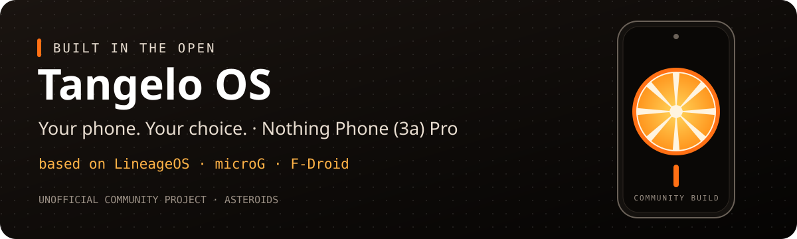

<p align="center"></p>

# Tangelo OS

[](https://github.com/YZUe1980/tangelo-os/actions/workflows/validate.yml)

**Your phone. Your apps. Your choice.**

[Deutsch](README.md) · [Build guide](docs/BUILD.md) · [Device status](docs/STATUS.md) · [Roadmap](docs/ROADMAP.md) · [Contribute](CONTRIBUTING.md)

**Tangelo OS** is an unofficial Android 16 system for the **Nothing Phone (3a) Pro**. It is based on **LineageOS 23.2** and ships **microG** and **F-Droid** without preinstalled Google services. Next, it is being shaped around **Infomaniak** as the central service for mail, contacts, calendars, files and backup. We publish the build recipe, source revisions and test results so others can inspect the work and help improve it.

**Development preview:** the system runs on our A059P with Android 16 and kernel 6.6. Encryption, SELinux Enforcing, Magisk root, calls with VoLTE, connectivity, cameras, microG and the app stores are verified; only Glyph is still faulty. No public release is available yet.

*The name:* a tangelo is a cross between a grapefruit and a mandarin. Tangelo OS is a cross as well: LineageOS, microG and Infomaniak, combined into something of its own.

## What Tangelo OS is

| Component | State |
| --- | --- |
| Device | Nothing Phone (3a) Pro, A059P, `asteroids` |
| Base | LineageOS 23.2 with the device maintainer's Linux 6.6 trees |
| Google replacement | microG in place of proprietary Google Play Services |
| Apps | F-Droid built in as the app store; all bundled apps are open source. Aurora Store can be installed from F-Droid by anyone who needs Google Play apps |
| Infomaniak (in progress) | kSync for contacts and calendars in the system apps, Infomaniak Mail, kDrive, backup to kDrive ([APPS.md](docs/APPS.md)) |
| Updates | Through the built-in Updater ([OTA.md](docs/OTA.md)) |
| Root | Optional Magisk, verified after an unmodified first boot |
| Development | Public manifests, scripts, findings and issue tracking |

## “Without Google”, with a clear meaning

Tangelo OS has no preinstalled proprietary Google Play Services or Google apps. That does **not** mean every possible Google connection disappears: optional microG features can connect to Google. Aurora Store is deliberately not preinstalled, because it accesses Google Play and Google's terms of service make no allowance for third-party clients; installing it from F-Droid is each user's own choice. Network defaults and remaining dependencies are part of the work we document.

The build also needs proprietary hardware support files. **This repository is open source; the entire firmware stack is not.** It contains build configuration and links to upstream sources, rather than firmware archives, APKs or private signing keys.

## Follow the work

Build, installation, the kernel 6.1 → 6.6 transition, boot and optional root have passed on the A059P test phone; see the [installation record](docs/INSTALLATION.md). The device tests of 2026-11-03 passed except for Glyph; see the [status page](docs/STATUS.md). The [roadmap](docs/ROADMAP.md) lists the next steps: a build from current sources with built-in updates, then the Infomaniak integration.

## Build it

```bash
git clone https://github.com/YZUe1980/tangelo-os.git
cd tangelo-os
./scripts/build.sh --dry-run
./scripts/build.sh
```

Read the [build guide](docs/BUILD.md) first for hardware requirements, source modes and signing-key storage. The default uses the recorded source snapshot; a tracking mode follows upstream branches. The new wrapper itself has not yet completed a fresh end-to-end build.

## Help shape the project

Useful contributions include reviewing device changes, documenting reproducible failures, checking microG integration, improving translations and testing clearly identified builds. Start with [CONTRIBUTING.md](CONTRIBUTING.md). Please use GitHub issues for this project's work and include the exact build revision with reports.

## Credits and licensing

Tangelo OS builds on [LineageOS](https://github.com/LineageOS), [NullDebris's device and kernel work](https://github.com/NullDebris), [LineageOS for microG's build tooling](https://github.com/lineageos4microg/docker-lineage-cicd), [microG](https://microg.org/) and [F-Droid](https://f-droid.org/). The original device-tree contributors retain their credits in the upstream sources.

New scripts and documentation in this repository are licensed under [Apache-2.0](LICENSE). Upstream software and proprietary hardware files retain their own licenses; see [third-party notes](docs/THIRD_PARTY.md). Tangelo OS is an independent community project, unaffiliated with Nothing, the LineageOS project or Infomaniak.

GitHub Actions validates scripts and manifests on changes. The full Android build currently runs on the development machine. [CI details](docs/CI.md).
