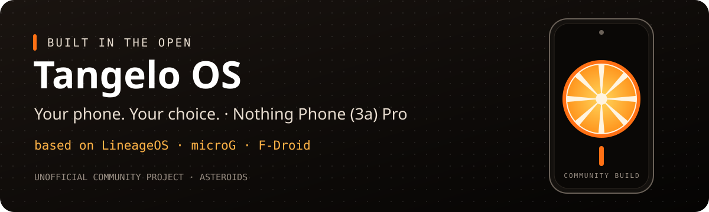

# Tangelo OS

**Dein Handy. Deine Apps. Deine Entscheidung.**

[Website](https://yzue1980.github.io/tangelo-os/) · [English](README.en.md) · [Bauanleitung](docs/BUILD.md) · [Gerätestatus](docs/STATUS.md) · [Fahrplan](docs/ROADMAP.md) · [Nächste Schritte](docs/NEXT-STEPS.md) · [Mitmachen](CONTRIBUTING.md)

**Tangelo OS** ist ein inoffizielles Android-16-System für das **Nothing Phone (3a) Pro**. Es basiert auf **LineageOS 23.2** und bringt **microG und F-Droid** mit, ohne vorinstallierte Google-Dienste. Als nächster Schritt wird es auf **Infomaniak** als zentralen Dienst für Mail, Kontakte, Kalender, Dateien und Backup ausgerichtet. Build-Konfiguration, Quellenstände und Testergebnisse sind öffentlich, damit andere die Arbeit nachvollziehen und verbessern können.

**Entwicklungsstand:** Das System läuft auf unserem A059P mit Android 16 und Kernel 6.6. Verschlüsselung, Magisk-Root, Telefonie mit VoLTE, Verbindungen, Kameras, microG und die App-Stores sind geprüft; offen ist nur Glyph. Eine öffentliche Veröffentlichung gibt es bisher nicht.

*Der Name:* Eine Tangelo ist eine Kreuzung aus Grapefruit und Mandarine. Tangelo OS ist ebenso eine Kreuzung: LineageOS, microG und Infomaniak, zusammengesetzt zu etwas Eigenem.

## Was Tangelo OS ausmacht

- **Ohne Google-Dienste:** microG ersetzt die proprietären Google Play-Dienste.
- **Apps nach eigener Wahl:** F-Droid ist als App-Store eingebaut; alle mitgelieferten Apps sind quelloffen. Wer Apps aus Google Play braucht, kann Aurora Store selbst aus F-Droid installieren.
- **Infomaniak-Integration (in Arbeit):** Kontakte und Kalender über kSync direkt in den System-Apps, Infomaniak Mail, kDrive und Backups aufs kDrive. Details in [APPS.md](docs/APPS.md).
- **Updates über den eingebauten Updater:** künftige Versionen kommen direkt aufs Handy ([OTA.md](docs/OTA.md)).
- **Nachvollziehbare Entwicklung:** feste Quellenstände, offene Skripte und dokumentierte Tests.
- **Optionales Root:** Magisk lässt sich nach dem ersten Start installieren.

## Was „ohne Google“ hier bedeutet

Tangelo OS enthält keine vorinstallierten proprietären Google Play-Dienste und Google-Apps. Optionale Funktionen von microG können Google-Verbindungen herstellen. Aurora Store ist bewusst nicht vorinstalliert, weil es auf Google Play zugreift und Googles Nutzungsbedingungen dafür keinen Fremdclient vorsehen; ob man es aus F-Droid nachinstalliert, entscheidet jeder selbst. Verbleibende Netzwerk-Standardwerte und Abhängigkeiten dokumentieren wir ausdrücklich.

Außerdem benötigt das Gerät proprietäre Treiber- und Firmwarebestandteile. **Das Repository ist Open Source; der gesamte Firmware-Stack ist es nicht.** Hier veröffentlichen wir die Konfiguration und Verweise auf die Quellen. Firmwarearchive, APKs, private Signierschlüssel und persönliche Gerätedaten gehören nicht hinein.

## So geht es weiter

Bau, Installation und Start auf dem **A059P** sind erfolgreich, einschließlich des Wechsels von Kernel 6.1 auf 6.6. Der [Installationsbericht](docs/INSTALLATION.md) hält den bestätigten Ablauf fest, der [Statusbericht](docs/STATUS.md) die Gerätetests vom 3. November 2026. Seit dem Bau vom 3. November 2026 (aktuelle Quellen, Tangelo-OS-Apps-Repo, Infomaniak-Apps, gehärteter `user`-Build) kommen Updates über den eingebauten Updater; Glyph funktioniert damit. Der [Fahrplan](docs/ROADMAP.md) zeigt die nächsten Schritte.

Mit der [Bauanleitung](docs/BUILD.md) lässt sich der Entwicklungsstand selbst bauen; der neue Wrapper ist noch nicht durch einen vollständigen frischen Bau bestätigt.

## Mitmachen

Du kennst dich mit Android-Gerätequellen aus, kannst Fehler sauber nachstellen oder möchtest die Dokumentation verbessern? Beiträge sind willkommen. Bitte lies [CONTRIBUTING.md](CONTRIBUTING.md) und nenne bei Fehlerberichten den genauen Build-Stand.

## Grundlagen und Lizenzen

Tangelo OS basiert auf LineageOS, NullDebris' Geräte- und Kernelquellen, LineageOS for microG, microG und F-Droid. Unsere neuen Skripte und Texte stehen unter [Apache-2.0](LICENSE); fremde Komponenten behalten ihre jeweiligen Lizenzen ([Übersicht](docs/THIRD_PARTY.md)). Tangelo OS ist ein unabhängiges Community-Projekt und kein offizielles Angebot von Nothing, LineageOS oder Infomaniak.

GitHub Actions prüft Skripte und Manifeste bei Änderungen automatisch. Der vollständige Android-Bau läuft derzeit auf dem Entwicklungsrechner. [Details zur CI](docs/CI.md).
